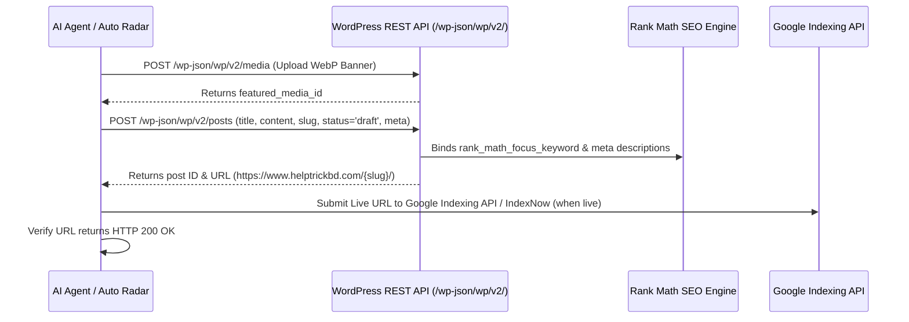

# 03_PUBLISHING_PERMALINK_RULES.md — Publishing & Custom Permalink Governance
### Helptrickbd.com WordPress REST API, Clean Slugs & Indexing Protocol

> [!IMPORTANT]
> **CLEAN PERMALINK STANDARD**: On WordPress (https://www.helptrickbd.com), permalinks are permanently configured to Post Name (`/%postname%/`). Every published post must have a clean, lowercase, hyphenated English keyword slug (e.g., `nu-honours-2nd-year-exam-routine`). Zero dates, zero `.html` extensions, and zero random numeric suffixes.

---

## 1. WordPress Native Clean Permalink Standards
Whenever minting a new article on WordPress, follow this protocol:



### Detailed Execution:
1. **Clean Slug Selection (ক্লিন স্লাগ নির্ধারণ)**:
   - Always formulate a concise, keyword-rich English slug matching user search intent (e.g., `ssc-bangla-1st-paper-creative-questions`).
   - Format: Lowercase, alphanumeric, hyphen-separated. Zero spaces, zero Bengali characters, zero `.html`.
2. **Direct Bengali Title & Excerpt Assignment**:
   - The post `title` in WordPress holds the full, rich Bengali headline (e.g., `এসএসসি ২০২৭ বাংলা ১ম পত্র সৃজনশীল প্রশ্নব্যাংক ও সাজেশন্স`).
   - The `slug` field (`post_name`) is directly bound to the clean English slug in the same API request.
   - No 2-step hacking needed: WordPress natively keeps the clean permalink while displaying rich Bengali typography everywhere.
3. **Draft vs Live Default**:
   - By default, automated scripts create posts with `status: "draft"` to enable editorial review.
   - When verified or instructed by user, posts transition to `status: "publish"`.

---

## 2. WordPress REST API Publishing Workflow (`tools/wp_publisher/`)
1. **Credentials Management**:
   - Authentication is handled via WordPress Application Passwords stored in `tools/wp_publisher/config.json`.
   - Never expose application passwords in public commits.
2. **Featured Media Binding**:
   - Upload official 16:9 WebP banner to `/wp-json/wp/v2/media`.
   - Set the returned attachment ID as `featured_media`.
3. **Rank Math SEO Postmeta Integration & 90+ Score Mandate**:
   - Every published post MUST guarantee a **90+ green score** in Rank Math SEO with zero red errors:
     * `rank_math_focus_keyword`: ১টি একক, বিষয়ভিত্তিক ১০০% ইউনিক ও গুগল হাই-সার্চ ভলিউম ফোকাস কি-ওয়ার্ড (যেমন: `অনার্স ২য় বর্ষ পরীক্ষার গাইড`, `এসএসসি বাংলা ১ম পত্র মডেল টেস্ট`)। কোনো দুটি পোস্টে একই কি-ওয়ার্ড ব্যবহার সম্পূর্ণ নিষিদ্ধ (Zero Cannibalization)।
     * `rank_math_title`: এসইও টাইটেল ও গুটেনবার্গ পোস্ট টাইটেল উভয়ই ফোকাস কি-ওয়ার্ড দিয়ে শুরু হবে এবং শেষে `- Best Complete Guide 2026` থাকবে। ফর্ম্যাট: `{Focus Keyword}: {Subject/Topic} - Best Complete Guide 2026` (সর্বোচ্চ ৬০ ক্যারেক্টার)।
     * `rank_math_description`: ১২০–১৫৫ ক্যারেক্টারের আকর্ষণীয় মেটা ডেসক্রিপশন যা ফোকাস কি-ওয়ার্ড দিয়ে শুরু হবে।
     * `rank_math_robots`: `index, follow, max-snippet:-1, max-video-preview:-1, max-image-preview:large`।
   - **কনটেন্ট স্ট্রাকচার ও রিড্যাবিলিটি মানদণ্ড**:
     * প্যারাগ্রাফ দৈর্ঘ্য: প্রতিটি প্যারাগ্রাফ অনধিক ৭০ শব্দের মধ্যে সীমাবদ্ধ থাকতে হবে (স্বল্প দৈর্ঘ্যের প্যারাগ্রাফ)।
     * সূচিপত্র: ভূমিকা প্যারাগ্রাফের পরেই নেটিভ গুটেনবার্গ ব্লক `<!-- wp:rank-math/toc-block {"title":"সূচিপত্র","listStyle":"ul"} --><div class="wp-block-rank-math-toc-block" id="rank-math-toc"><h2>সূচিপত্র</h2><nav><ul></ul></nav></div><!-- /wp:rank-math/toc-block -->` উপস্থিত থাকতে হবে।
     * কি-ওয়ার্ড ডেনসিটি: বিষয়বস্তুর স্বাভাবিক ছন্দে ৮–১২ বার ফোকাস কি-ওয়ার্ড সন্নিবেশ (০.৮%–১.২% ঘনত্ব)।
     * ইমেজ অল্ট ট্যাগ: ফিচার্ড ইমেজ ও ভেতরের সকল ছবির `alt` ট্যাগে ফোকাস কি-ওয়ার্ড সংযুক্ত থাকতে হবে।
     * এক্সটার্নাল লিংক: কমপক্ষে ১টি প্রাসঙ্গিক সরকারি/শিক্ষা বোর্ড ডু-ফলো লিংক (`rel="noopener"`) এবং ২–৩টি অভ্যন্তরীণ লিংক থাকতে হবে।
     * কনটেন্ট এআই: র‍্যাংক ম্যাথ প্রো ড্যাশবোর্ডে Content AI মডিউল অফ রাখতে হবে যাতে স্কোর পেনাল্টি না আসে।

---

## 3. Real-Time Indexing and Hub Notification
1. **Google Indexing API & IndexNow**:
   - When published live, immediately submit the URL:
     ```bash
     python tools/indexer/index_now.py --url https://www.helptrickbd.com/<slug>/
     ```
2. **WebSub (PubSubHubbub) Real-Time Notification**:
   - Instant feed pinging to Google PubSubHubbub hub (`https://pubsubhubbub.appspot.com/publish`) via `tools/indexer/pubsub_hub_pinger.py`.
